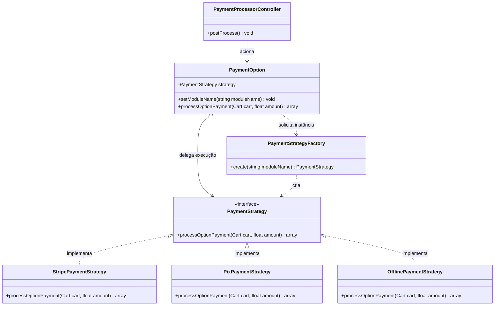

# Refatoração da Camada de Pagamentos — QloApps (Padrão Strategy)

Este projeto documenta a refatoração arquitetural do módulo de processamento de pagamentos do **QloApps** (sistema de reservas hoteleiras baseado em PrestaShop). A intervenção substitui a lógica condicional acoplada do sistema legado pelo **Padrão de Projeto Strategy (GoF)** combinado a uma **Factory**, além de modernizar a comunicação entre frontend e backend via requisições assíncronas (AJAX).

---

## Objetivos da Mudança

* **Redução de Acoplamento:** Isolar as regras de negócio de cada gateway de pagamento (Cartão de Crédito/Stripe, PIX e Pagamento na Recepção) em classes independentes.
* **Conformidade com SOLID:**
  * **SRP (Princípio da Responsabilidade Única):** Cada classe de estratégia cuida exclusivamente do seu próprio método de pagamento.
  * **OCP (Princípio Aberto/Fechado):** Permitir a adição de novos métodos de pagamento sem modificar o código central de processamento (`PaymentOption`).
* **Eliminação de Complexidade Ciclomática:** Remover cadeias extensas de `if/else` ou `switch/case` espalhadas pelo fluxo de checkout.
* **Modernização do Fluxo de Checkout:** Substituir redirecionamentos síncronos e múltiplos hooks de módulos por um controlador centralizado que responde em JSON via `Fetch API`.

---

## Antes vs. Depois

| Aspecto | Antes (Arquitetura Legada) | Depois (Arquitetura com Strategy) |
| :--- | :--- | :--- |
| **Organização da Lógica** | Condicionais acopladas e fluxos fragmentados por hooks de módulos (`{$HOOK_PAYMENT}`). | Algoritmos encapsulados em classes dedicadas sob um contrato único (`PaymentStrategy`). |
| **Extensibilidade** | Adicionar um novo gateway exigia alterar arquivos do núcleo e criar desvios condicionais. | Basta criar uma nova classe que implemente `PaymentStrategy` e registrá-la na Factory. |
| **Risco de Regressão** | Alto: alterações em um método de pagamento podiam afetar outros métodos no mesmo fluxo. | Baixo: cada estratégia opera de forma isolada, sem efeitos colaterais nas demais. |
| **Frontend & UX** | Envio tradicional de formulários com recarregamento completo de página. | Requisição assíncrona (`POST` com `FormData`) exibindo feedback e QR Code dinamicamente. |
| **Testabilidade** | Baixa, devido à dependência direta de estado global e condicionais embutidas. | Alta, possibilitando testes unitários independentes por estratégia. |

### Comparação Conceitual do Código

**Antes (lógica condicional rígida):**
```php
// O núcleo precisava conhecer os detalhes de cada meio de pagamento
if ($moduleName === 'stripe') {
    // lógica de cobrança via cartão...
} elseif ($moduleName === 'pix') {
    // lógica de geração de QR Code...
} elseif ($moduleName === 'offline') {
    // lógica de reserva para pagamento na recepção...
}
```

**Depois (delegação polimórfica):**
```php
// O contexto apenas delega a execução para a estratégia recebida
$paymentOption = new Core_Business_Payment_PaymentOption();
$paymentOption->setModuleName($moduleName);
$result = $paymentOption->processOptionPayment($cart, $amount);
```

---

## O Que Foi Mudado no Código

### Estrutura de Arquivos

```text
QloApps/
├── Core/
│   └── Business/
│       └── Payment/
│           ├── PaymentOption.php                      # Contexto refatorado
│           └── Strategy/
│               ├── PaymentStrategy.php                # Interface (contrato)
│               ├── PaymentStrategyFactory.php         # Fábrica de estratégias
│               ├── StripePaymentStrategy.php          # Estratégia concreta: Cartão
│               ├── PixPaymentStrategy.php             # Estratégia concreta: PIX
│               └── OfflinePaymentStrategy.php         # Estratégia concreta: Recepção
├── controllers/
│   └── front/
│       └── PaymentProcessorController.php             # Controlador central (endpoint AJAX)
└── themes/
    └── hotel-reservation-theme/
        └── order-payment.tpl                          # Interface e script Fetch API
```

### Detalhamento das Alterações

1. **Camada de Domínio (`Core/Business/Payment/`):**
   * **Criação da interface `PaymentStrategy`:** Define o contrato obrigatório `processOptionPayment($cart, $amount)` para todos os meios de pagamento.
   * **Criação das estratégias concretas:** Implementação de `StripePaymentStrategy`, `PixPaymentStrategy` e `OfflinePaymentStrategy` encapsulando o comportamento específico de cada meio.
   * **Criação da `PaymentStrategyFactory`:** Centraliza a instanciação da estratégia adequada a partir do identificador enviado (`stripe`, `pix`, `offline`).
   * **Refatoração de `PaymentOption`:** Passou a atuar como o *Contexto* do padrão Strategy, solicitando a instância à Factory em `setModuleName()` e delegando a execução de forma polimórfica em `processOptionPayment()`.
   * **Padronização de nomenclatura física:** Os arquivos foram padronizados sem prefixos redundantes no nome físico para manter organização coerente com a pasta `Core/Business/Payment/Strategy/`.

2. **Controlador Central (`controllers/front/PaymentProcessorController.php`):**
   * Criado como ponto único de entrada para requisições de pagamento do checkout.
   * **Validação adaptada para hotelaria:** Removida a obrigatoriedade de endereço de entrega físico (`id_address_delivery`) e de contexto de módulo específico (`$this->module->active`), validando apenas carrinho ativo, cliente autenticado e endereço de cobrança (`id_address_invoice`).
   * **Carregamento explícito de dependências:** Implementado carregamento via `require_once` com caminho relativo resolvido por `dirname(__FILE__)` para contornar limitações do Autoloader e do cache de índice de classes (`cache/class_index.php`) do QloApps.

3. **Frontend (`themes/hotel-reservation-theme/order-payment.tpl`):**
   * Substituição da inclusão legada `order-payment-classic.tpl` por um bloco unificado com inputs `radio` (`stripe`, `pix`, `offline`) e botão de confirmação (`#btn-confirm-payment`).
   * Adição de script JavaScript com `Fetch API` e `FormData` disparando requisições `POST` para `index.php?controller=PaymentProcessor&ajax=true`, tratando respostas JSON para exibição de QR Code (PIX), confirmação de reserva ou mensagens de erro.

---

## Como Funciona Agora

### Diagrama de Classes (UML)



### Fluxo de Execução Passo a Passo

1. **Seleção no Frontend:** Na tela de checkout (`order-payment.tpl`), o hóspede seleciona um método de pagamento (`stripe`, `pix` ou `offline`) e clica em **Confirmar Pedido**.
2. **Requisição Assíncrona:** O JavaScript intercepta o clique, empacota o parâmetro `payment_module` via `FormData` e envia uma requisição `POST` para `index.php?controller=PaymentProcessor&ajax=true`.
3. **Recepção e Validação:** O `PaymentProcessorControllerCore::postProcess()` recebe o `payment_module`, verifica a integridade do carrinho e calcula o valor total da reserva (`$cart->getOrderTotal()`).
4. **Resolução da Estratégia:** O controlador instancia `Core_Business_Payment_PaymentOption` e chama `setModuleName($moduleName)`. Internamente, a `PaymentStrategyFactory` identifica o método e retorna a instância concreta correspondente (`StripePaymentStrategy`, `PixPaymentStrategy` ou `OfflinePaymentStrategy`). 5. **Execução Polimórfica:** O método `processOptionPayment($cart, $amount)` delega a execução para a estratégia ativa sem precisar saber qual implementação concreta está rodando. 6. **Resposta à Interface:** O controlador retorna o resultado serializado em JSON (`success`, `message` e `data`) via `$this->ajaxDie()`. O frontend processa a resposta — exibindo o QR Code gerado no caso do PIX ou redirecionando para a página de confirmação da reserva.

---

## Como Adicionar um Novo Método de Pagamento

Com a nova arquitetura, incluir um novo meio de pagamento (ex.: **PayPal**) exige apenas três passos, sem alterar `PaymentOption` ou a lógica do controlador:

1. Criar a classe `PayPalPaymentStrategy.php` em `Core/Business/Payment/Strategy/` implementando `PaymentStrategy`.
2. Registrar o identificador `'paypal'` na `PaymentStrategyFactory` (e incluí-lo no carregamento do controlador).
3. Adicionar a nova opção `<input type="radio" name="payment_method" value="paypal">` no template `order-payment.tpl`.
